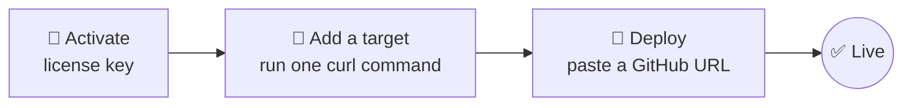

<div align="center">


### Self-hosted PaaS for the hardware you already own

Deploy any GitHub repo to an **old Android phone**, a **Raspberry Pi**, a **Linux server** or a **Windows PC** in a few clicks.<br/>
No accounts. No telemetry. No monthly bills.

[](https://github.com/JPEG111/anydeploy-releases/releases/latest)
[](https://github.com/JPEG111/anydeploy-releases/releases)
[](#download)
[](#download)

[](./LICENSE)

**[⬇️ Download](#download)** · **[✨ Features](#features)** · **[🎯 Targets](#targets)** · **[❓ FAQ](#faq)** · **[🐛 Report a bug](../../issues/new?template=bug_report.md)** · **[📝 Changelog](./CHANGELOG.md)**

</div>

---

## ⚡ Three steps, one URL



1. **Activate** with your license key.
2. Click **Add Target**, pick your device and run the one-line `curl` command the app gives you.
3. Click **Deploy**, paste any GitHub URL and you're done.

No manual config files, no nginx tutorials, no PM2 docs.

---

<a id="download"></a>

## ⬇️ Download

<div align="center">

| Platform | Download | Size |
| :-- | :-- | :-- |
| 🪟 **Windows 10+** (64-bit) | [**anyDeploy-Setup.exe**](../../releases/latest/download/anyDeploy-Setup.exe) | ~115 MB installer, ~370 MB installed |
| 🐧 **Linux x64** (any glibc 2.17+ distro) | [**anyDeploy.AppImage**](../../releases/latest/download/anyDeploy.AppImage) | ~140 MB, runs from the file |
| 🍎 **macOS** | *Coming soon.* Email [support@anydeploy.app](mailto:support@anydeploy.app) for early access | |

</div>

<details>
<summary><b>🪟 Windows: "Windows protected your PC"?</b></summary>
<br/>

SmartScreen shows this warning the first time you install, because the installer isn't code-signed yet. Click **More info**, then **Run anyway**.
</details>

<details>
<summary><b>🐧 Linux: how do I run the AppImage?</b></summary>
<br/>

Works on Ubuntu 16.04+, Debian 9+, Fedora 25+ and any distro with glibc 2.17+. Mark it executable first:

```bash
chmod +x anyDeploy.AppImage
./anyDeploy.AppImage
```
Or just double-click it after `chmod`.
</details>

<details>
<summary><b>🔒 Verify your download (SHA-256)</b></summary>
<br/>

Every release ships a `SHA256SUMS.txt`. Its entries name the versioned files (`anyDeploy-Setup-<version>.exe`, `anyDeploy-<version>.AppImage`), which are byte-identical to the links above.

```powershell
# Windows (PowerShell)
Get-FileHash -Algorithm SHA256 .\anyDeploy-Setup.exe
```
```bash
# Linux
sha256sum -c SHA256SUMS.txt
```
</details>

---

## 🧩 What you can deploy

<table>
<tr>
<td width="25%" valign="top">

**🌐 Web apps**
- Next.js
- Vite / React
- Vue · Svelte · SvelteKit
- Astro
- Streamlit
- Plain HTML

</td>
<td width="25%" valign="top">

**🔌 APIs**
- Express · Fastify · NestJS
- Hono · Elysia (Bun)
- Python (Flask / FastAPI / Django)
- Go
- Rust

</td>
<td width="25%" valign="top">

**🤖 Bots**
- Discord (discord.js / discord.py)
- Telegram (telegraf)
- Slack
- WhatsApp
- Twitch
- Matrix

</td>
<td width="25%" valign="top">

**📦 Static sites**
- Any framework that outputs `dist/` or `build/`

</td>
</tr>
</table>

---

<a id="targets"></a>

## 🎯 Where you can deploy

| | Target | Setup time | Best for |
| :-: | :-- | :-: | :-- |
| 📱 | **Android phone** (Termux) | ~10 min | Turning your old phone into a server |
| ☁️ | **Managed Cloud** *(Pro plan)* | ~1 min | We spin up a server for you: no VPS account, no SSH |
| 🍓 | **Raspberry Pi** | ~5 min | Pi 3 / 4 / 5 and Pi Zero |
| 🐧 | **Another Linux computer** | ~5 min | A desktop, a laptop or a friend's box |
| 🪟 | **Windows + WSL2** | ~10 min | Another Windows PC on your LAN |
| 💻 | **This computer** | instant | The machine running anyDeploy itself |

---

<a id="features"></a>

## ✨ What gets automated

| | Feature | |
| :-: | :-- | :-- |
| 🌍 | **nginx** | Virtual host config generated for you |
| ♻️ | **PM2** | Process management with auto-restart on crash and boot |
| 🚇 | **Cloudflare Tunnel + DNS** | When you connect a Cloudflare account |
| 🔐 | **Let's Encrypt** | Free SSL certificates |
| 🔧 | **Environment variables** | Per project, scoped to Production / Preview / Development, encrypted at rest |
| ⏰ | **Cron jobs** | Scheduled tasks without editing crontab |
| 💾 | **Database tracking** | The Storage tab shows live file sizes |

<!-- Screenshots and GIFs go here: they are the single biggest driver of stars and downloads. -->

---

## 🎁 More built in

<table>
<tr>
<td width="50%" valign="top">

**🔗 Free public links, no domain needed**<br/>
Every project can get a free Cloudflare tunnel link instantly. Connect your own domain when you want a permanent address, with step-by-step help for Porkbun, GoDaddy, Namecheap and other registrars.

</td>
<td width="50%" valign="top">

**🔁 Auto-deploy on every push**<br/>
Push to GitHub and anyDeploy redeploys, with no webhook setup. Works with any branch.

</td>
</tr>
<tr>
<td valign="top">

**🪄 AI Website Builder**<br/>
Describe a site and watch it stream in live. You can add your own images, fonts and 3D models, preview the real build, then deploy. *Agent Mode* reviews and fixes its own work.

</td>
<td valign="top">

**💻 Terminal and live health**<br/>
Run commands on your device from inside each project. Live CPU, RAM and disk for every device, with clear, collapsible deploy logs.

</td>
</tr>
<tr>
<td valign="top">

**⏹️ Cancel any deploy**<br/>
Stop a long build mid-way and the device is left in a clean state.

</td>
<td valign="top">

**⬆️ Small, automatic updates**<br/>
The app updates itself and downloads only the parts that changed. You keep all your projects and settings.

</td>
</tr>
</table>

---

## 💳 Plans

| Plan | What you get |
| :-- | :-- |
| 🆓 **Free trial** | 2 days, started from inside the app. No payment needed |
| ⭐ **Pro** | Monthly subscription, including **Managed Cloud** |
| ♾️ **Lifetime** | Pay once |

You choose and manage your plan inside the app.

---

## 🛡️ Privacy

- **No accounts.** You activate with a license key or a free trial.
- **No usage analytics.** The app doesn't track how you use it.
- **License checks.** To validate your license or trial, the app contacts the anyDeploy licensing service, including each time it starts.
- **Your code stays on your hardware.** Deploys go to the targets you add. Managed Cloud is the only option where we host the server for you.

---

<a id="faq"></a>

## ❓ FAQ

<details>
<summary><b>How is this different from Heroku, Vercel or Railway?</b></summary>
<br/>

Those platforms run your app on their servers and bill you monthly. anyDeploy runs it on hardware you already own and handles the server setup (nginx, PM2, SSL, tunnels) for you.
</details>

<details>
<summary><b>Do I need to know Linux or SSH?</b></summary>
<br/>

No. Adding a target is one copy-pasted `curl` command, and the app does the rest.
</details>

<details>
<summary><b>Can I really host on an old Android phone?</b></summary>
<br/>

Yes, via Termux. The app walks you through it in three numbered steps and asks first whether your phone is rooted, so you only see the steps that apply to you.
</details>

<details>
<summary><b>How do I get a license?</b></summary>
<br/>

Start the free 2-day trial and pick a plan from inside the app. Your key activates automatically after checkout. For anything else, email [support@anydeploy.app](mailto:support@anydeploy.app).
</details>

---

## 💬 Support

| Need | Where |
| :-- | :-- |
| 🐛 Bug report | [Open a bug issue](../../issues/new?template=bug_report.md) |
| 💡 Feature request | [Open a feature issue](../../issues/new?template=feature_request.md) |
| 🔒 Security issue | See [SECURITY.md](./SECURITY.md). Please don't post it publicly |
| 💼 Sales and licensing | [support@anydeploy.app](mailto:support@anydeploy.app) |

---

## 📄 License

anyDeploy is **proprietary software**. This repository contains release binaries, documentation and the changelog only. The app is closed-source, and using it requires a valid license key. See [LICENSE](./LICENSE) for the full terms.

© 2026 Skandar, trading as anyDeploy.

<sub>All product names, logos and brands mentioned here (including GitHub, Cloudflare, Raspberry Pi, Android, Windows, Linux, macOS, Discord, Telegram, Slack, WhatsApp, Twitch, Heroku, Vercel and Railway) are the property of their respective owners. They're used only to describe compatibility. anyDeploy isn't affiliated with or endorsed by any of them.</sub>

<div align="center">


**anyDeploy** · *your hardware, your data.*

</div>
